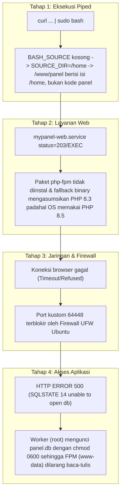

# Dokumentasi Analisa & Perbaikan Master Installer: Almusa Panel

> **Panduan Komprehensif Diagnosa Masalah, Analisis Akar Penyebab (Root Cause Analysis), dan Solusi Arsitektur Hak Akses Multi-User serta Installer Otomatis**  
> Versi Dokumen: 1.0.0 · Tanggal Rilis: 30 Oktober 2026

---

## 📌 Daftar Isi
1. [Latar Belakang & Kronologi Kasus](#1-latar-belakang--kronologi-kasus)
2. [Analisis 4 Rantai Kegagalan (Root Cause Analysis)](#2-analisis-4-rantai-kegagalan-root-cause-analysis)
   - [Kegagalan 1: Eksekusi Piped Script & Direktori Sumber Keliru](#kegagalan-1-eksekusi-piped-script--direktori-sumber-keliru)
   - [Kegagalan 2: Web Interface STOPPED (status=203/EXEC)](#kegagalan-2-web-interface-stopped-status203exec)
   - [Kegagalan 3: Web UI Unreachable (Port & Firewall UFW)](#kegagalan-3-web-ui-unreachable-port--firewall-ufw)
   - [Kegagalan 4: HTTP ERROR 500 (Konflik Hak Akses SQLite Root vs www-data)](#kegagalan-4-http-error-500-konflik-hak-akses-sqlite-root-vs-www-data)
3. [Arsitektur Solusi & Perubahan Kode](#3-arsitektur-solusi--perubahan-kode)
   - [1. Bootstrap Script Mandiri (almusa.sh)](#1-bootstrap-script-mandiri-almusash)
   - [2. Refaktor Master Installer (scripts/install.sh)](#2-refaktor-master-installer-scriptsinstallsh)
   - [3. Standarisasi Izin SQLite & Helper (app/Core/Database.php)](#3-standarisasi-izin-sqlite--helper-appcoredatabasephp)
   - [4. Sinkronisasi Controller Web (app/Controllers/DashboardController.php)](#4-sinkronisasi-controller-web-appcontrollersdashboardcontrollerphp)
   - [5. Pencegahan Regresi Updater (scripts/update_panel.sh)](#5-pencegahan-regresi-updater-scriptsupdate_panelsh)
   - [6. Sinkronisasi CLI Helper (cli.sh)](#6-sinkronisasi-cli-helper-clish)
4. [Prinsip Keamanan Berkas & Mode WAL SQLite pada Linux](#4-prinsip-keamanan-berkas--mode-wal-sqlite-pada-linux)
5. [Panduan Deployment ke bidanokta.xyz & Prosedur Uji Coba](#5-panduan-deployment-ke-bidanoktaxyz--prosedur-uji-coba)
6. [Daftar Periksa Verifikasi (Testing Checklist)](#6-daftar-periksa-verifikasi-testing-checklist)

---

## 1. Latar Belakang & Kronologi Kasus

Saat melakukan uji coba instalasi satu baris pada server Ubuntu yang baru (fresh install) menggunakan perintah:
```bash
curl -fsSL https://bidanokta.xyz/almusa.sh | sudo bash
```
ditemukan serangkaian pesan kesalahan beruntun yang menghambat panel hingga tidak dapat beroperasi secara otomatis. Berkas catatan [error.md](file:///home/afandi/almusa-panel/error.md) mendokumentasikan bagaimana sysadmin harus melakukan intervensi manual berkali-kali: mulai dari perbaikan folder sumber, perbaikan binary PHP-FPM, pembukaan port firewall, hingga pemberian permission file secara manual sebelum akhirnya panel dapat berjalan normal.

Dokumentasi ini mencatat diagnosa lengkap mengapa error tersebut terjadi dan bagaimana codebase Almusa Panel diperbaiki secara struktural agar instalasi di server Linux manapun dapat berjalan mulus tanpa hambatan (zero-friction).

---

## 2. Analisis 4 Rantai Kegagalan (Root Cause Analysis)



---

### Kegagalan 1: Eksekusi Piped Script & Direktori Sumber Keliru
* **Pesan Terminal:**
  ```text
  [3/7] Menyiapkan struktur direktori /www...
  [*] Menyiapkan tautan /www/panel ke /home...
  chmod: cannot access '/www/panel/data': No such file or directory
  ```
* **Akar Masalah:**
  1. Pada installer lama, direktori sumber dideteksi menggunakan:
     ```bash
     SOURCE_DIR="$( cd -P "$( dirname "${BASH_SOURCE[0]}" )/.." >/dev/null 2>&1 && pwd )"
     ```
  2. Saat bash mengeksekusi script langsung dari pipeline stdin (`curl ... | sudo bash`), variabel bawaan `${BASH_SOURCE[0]}` bernilai string kosong `""`.
  3. Perintah `dirname ""` mengembalikan `.` (current directory). Jika perintah dijalankan dari `/home/server-panel`, maka `cd -P "./.."` berpindah ke direktori `/home`.
  4. Akibatnya, perintah `cp -rf "$SOURCE_DIR"/* /www/panel/` malah menyalin seluruh isi `/home/*` ke `/www/panel/`. Kode sumber aplikasi Almusa Panel dari GitHub **sama sekali tidak terunduh**.
  5. Perintah `chmod 770 /www/panel/data` gagal karena folder `data` tidak ada di `/home`.
  6. Selain itu, berkas script pada URL `https://bidanokta.xyz/almusa.sh` ternyata terpotong (truncated) di baris 110 (`# 5. In`).

---

### Kegagalan 2: Web Interface STOPPED (`status=203/EXEC`)
* **Pesan Terminal:**
  ```text
  Panel Services Status:
   - Web Interface   : STOPPED
   - Worker Daemon   : ACTIVE (Running)
  ```
  Pada log systemd (`journalctl -u mypanel-web.service`):
  `Process: ExecStart=/usr/sbin/php-fpm8.3 ... (code=exited, status=203/EXEC)`
* **Akar Masalah:**
  1. Baris `apt-get install` lama hanya meminta: `php-cli php-sqlite3 php-curl php-mbstring php-xml`. Paket **`php-fpm`** tidak ada dalam daftar instalasi.
  2. Di Ubuntu (terutama dengan repositori Ondrej Sury `ppa:ondrej/php`), instalasi paket `php-cli` tanpa penomoran versi otomatis menarik rilis PHP tertinggi yang tersedia (misal PHP 8.5).
  3. Installer lama meng-hardcode binary ke:
     ```bash
     PHP_FPM_BIN=$(command -v php-fpm8.3 || command -v php-fpm || echo "/usr/sbin/php-fpm8.3")
     ```
     Karena paket `php-fpm` belum dipasang dan versi default server adalah 8.5 (bukan 8.3), path binary jatuh ke `/usr/sbin/php-fpm8.3` yang tidak ada di disk. Systemd melempar error `203/EXEC (No such file or directory)`.
  4. Folder socket `/run/php/` berada pada filesystem virtual memori (`tmpfs`). Jika server di-reboot, folder ini terhapus dan PHP-FPM tidak dapat membuat socket `almusa-panel.sock`.

---

### Kegagalan 3: Web UI Unreachable (Port & Firewall UFW)
* **Pesan Terminal / Browser:** Browser menampilkan pesan *Connection Refused* atau *Connection Timed Out* saat membuka `http://IP:64448/<entrance>`.
* **Akar Masalah:**
  1. Port default Almusa Panel (`64448`) adalah port kustom non-standar.
  2. Server Ubuntu modern umumnya mengaktifkan UFW (`Uncomplicated Firewall`). Karena installer lama tidak mendaftarkan aturan port, paket TCP menuju port 64448 langsung di-drop oleh kernel.

---

### Kegagalan 4: HTTP ERROR 500 (Konflik Hak Akses SQLite Root vs www-data)
* **Pesan Browser:** `HTTP ERROR 500 (Internal Server Error)`.
* **Pesan Log PHP:**
  `PDOException: SQLSTATE[HY000] [14] unable to open database file in /www/panel/app/Core/Database.php`
* **Akar Masalah:**
  1. Arsitektur Almusa Panel menggunakan 2 identitas proses:
     - `mypanel-worker.service` (`task.php`) berjalan terus-menerus sebagai **`root`**.
     - `mypanel-web.service` (Dedicated PHP-FPM) berjalan sebagai pengguna web **`www-data`**.
  2. Di dalam file [app/Core/Database.php](file:///home/afandi/almusa-panel/app/Core/Database.php), terdapat kode lama:
     ```php
     if (file_exists(self::$dbFile)) {
         @chmod(self::$dbFile, 0600);
     }
     ```
  3. Karena `task.php` (root) melakukan polling tabel setiap detik, fungsi `Database::getInstance()` dipanggil secara konstan oleh root. Perintah `@chmod(self::$dbFile, 0600)` mengunci izin berkas database `/www/panel/data/panel.db` menjadi `-rw-------` dengan pemilik `root:root`.
  4. Pengguna `www-data` yang melayani web browser sama sekali dilarang membaca atau menulis berkas berizin `0600` milik root.
  5. Terlebih lagi, SQLite menggunakan mode **WAL (Write-Ahead Logging)** yang mewajibkan proses memiliki hak baca-tulis pada berkas database serta **direktori penampungnya** (`/www/panel/data`) untuk membuat file sementara `panel.db-wal` dan `panel.db-shm`.
  6. Penolakan izin ini memicu fatal exception PDO yang berujung pada respon HTTP 500.

---

## 3. Arsitektur Solusi & Perubahan Kode

Berikut adalah pembaruan kode yang telah diterapkan di repositori untuk mengatasi seluruh permasalahan di atas secara permanen:

### 1. Bootstrap Script Mandiri ([almusa.sh](file:///home/afandi/almusa-panel/almusa.sh))
Dibuatkan script bootstrap baru di root repositori untuk kebutuhan eksekusi via URL (`curl ... | sudo bash`).
* Memeriksa hak akses root.
* Menginstal `curl`, `git`, dan `ca-certificates`.
* Mengunduh rilis Almusa Panel ke direktori sementara `/tmp/almusa-installer-$$` via `git clone --depth=1`.
* Menjalankan installer utama `scripts/install.sh` dari direktori yang terisolasi.
* Membersihkan direktori temporer setelah instalasi selesai.

```bash
#!/usr/bin/env bash
set -e
# [Validasi Root & Dependensi Dasar]
apt-get update -y && DEBIAN_FRONTEND=noninteractive apt-get install -y curl git ca-certificates
# [Unduh Repo Resmi ke Temp]
INSTALLER_TMP="/tmp/almusa-installer-$$"
git clone --depth=1 https://github.com/uwaisalqorni/almusa-panel.git "$INSTALLER_TMP"
# [Jalankan Installer Utama]
cd "$INSTALLER_TMP"
bash scripts/install.sh
rm -rf "$INSTALLER_TMP"
```

---

### 2. Refaktor Master Installer ([scripts/install.sh](file:///home/afandi/almusa-panel/scripts/install.sh))
* **Deteksi Jalur Pipe-Safe:** Installer kini memeriksa apakah file `app/bootstrap.php` ada di `$SOURCE_DIR`. Jika tidak ada (misalnya installer dieksekusi secara terisolasi tanpa clone), installer otomatis meng-clone repositori resmi dari GitHub ke `/tmp`.
* **Deteksi Versi PHP Aktif Secara Dinamis:**
  ```bash
  PHP_VER=$(php -r "echo PHP_MAJOR_VERSION . '.' . PHP_MINOR_VERSION;" 2>/dev/null || echo "8.3")
  DEBIAN_FRONTEND=noninteractive apt-get install -y \
      php${PHP_VER}-fpm php${PHP_VER}-cli php${PHP_VER}-sqlite3 \
      php${PHP_VER}-curl php${PHP_VER}-mbstring php${PHP_VER}-xml php${PHP_VER}-zip || \
  DEBIAN_FRONTEND=noninteractive apt-get install -y \
      php-fpm php-cli php-sqlite3 php-curl php-mbstring php-xml php-zip || true
  ```
* **Pencarian Binary PHP-FPM Otomatis:**
  ```bash
  PHP_FPM_BIN=""
  if [ -n "${PHP_VER:-}" ] && command -v "php-fpm${PHP_VER}" >/dev/null 2>&1; then
      PHP_FPM_BIN=$(command -v "php-fpm${PHP_VER}")
  elif command -v php-fpm >/dev/null 2>&1; then
      PHP_FPM_BIN=$(command -v php-fpm)
  else
      PHP_FPM_BIN=$(find /usr/sbin -name "php-fpm*" -executable 2>/dev/null | sort -V | tail -n 1)
  fi
  ```
* **Systemd `RuntimeDirectory=php`:** Ditambahkan pada unit `mypanel-web.service` agar `/run/php` dibuat otomatis saat boot dengan izin `0755`.
* **Otomasi Firewall UFW:** Jika firewall UFW aktif, port listen panel dibuka secara otomatis:
  ```bash
  if command -v ufw >/dev/null 2>&1 && ufw status | grep -q "Status: active"; then
      ufw allow "${PORT}/tcp" >/dev/null 2>&1 || true
      ufw reload >/dev/null 2>&1 || true
  fi
  ```
* **Penerapan Hak Akses Pasca-Inisialisasi Database:**
  ```bash
  chown -R www-data:www-data /www/panel
  chmod -R 755 /www/panel
  chmod 2775 /www/panel/data
  chmod 664 /www/panel/data/* 2>/dev/null || true
  ```

---

### 3. Standarisasi Izin SQLite & Helper ([app/Core/Database.php](file:///home/afandi/almusa-panel/app/Core/Database.php))
Ditambahkan metode pembantu untuk sinkronisasi kepemilikan dan hak akses aman:
```php
public static function isRoot(): bool
{
    if (function_exists('posix_getuid')) {
        return posix_getuid() === 0;
    }
    return (get_current_user() === 'root' || getenv('USER') === 'root');
}

public static function fixPermissions(string $path, int $mode = 0664): void
{
    if (file_exists($path)) {
        @chmod($path, $mode);
        if (self::isRoot()) {
            @chown($path, 'www-data');
            @chgrp($path, 'www-data');
        }
    }
}
```
* Pada `getInstance()`:
  - Direktori `/www/panel/data` dipastikan bermode `02775` (setgid) dan dimiliki oleh `www-data:www-data`.
  - Berkas database `panel.db`, `panel.db-wal`, dan `panel.db-shm` selalu disinkronkan ke mode `0664` dan grup `www-data`.
* Pada `autoMigrate()`:
  - Berkas `entrance.txt` dibuat dengan izin `0664` dan grup `www-data`.
  - Berkas `initial_credentials.txt` dibuat dengan izin `0660` dan grup `www-data`.

---

### 4. Sinkronisasi Controller Web ([app/Controllers/DashboardController.php](file:///home/afandi/almusa-panel/app/Controllers/DashboardController.php))
Saat pengguna mengubah secret entrance path melalui dashboard pengaturan web, izin berkas `data/entrance.txt` disimpan menggunakan:
```php
$entranceFile = $root . '/data/entrance.txt';
@file_put_contents($entranceFile, $entrance);
\App\Core\Database::fixPermissions($entranceFile, 0664);
```

---

### 5. Pencegahan Regresi Updater ([scripts/update_panel.sh](file:///home/afandi/almusa-panel/scripts/update_panel.sh))
Tahap pemulihan izin berkas pada script self-updater diperbarui agar tidak mengunci kembali berkas ke mode `700` atau `600`:
```bash
if [ -d "${PANEL_ROOT}/data" ]; then
    chown -R www-data:www-data "${PANEL_ROOT}/data" 2>/dev/null || true
    chmod 2775 "${PANEL_ROOT}/data" 2>/dev/null || true
    chmod 664 "${PANEL_ROOT}/data"/* 2>/dev/null || true
fi
```

---

### 6. Sinkronisasi CLI Helper ([cli.sh](file:///home/afandi/almusa-panel/cli.sh))
* **Ganti Port (`cmd_change_port`):** Selain menyimpan port baru ke database, script otomatis memperbarui blok `listen` pada `/www/panel/config/nginx-panel.conf`, membuka port baru di UFW firewall, me-reload Nginx, dan me-restart service panel.
* **Ganti Entrance (`cmd_change_entrance`):** Memastikan berkas `data/entrance.txt` yang ditulis oleh root disinkronkan dengan hak akses `0664` grup `www-data`.

---

## 4. Prinsip Keamanan Berkas & Mode WAL SQLite pada Linux

Mengapa kombinasi izin `02775` pada folder dan `0664` pada berkas database adalah solusi terbaik untuk Almusa Panel?

| Parameter | Pengaturan | Alasan Teknis |
| :--- | :--- | :--- |
| **User Pemilik** | `www-data` | Web interface berjalan sebagai pengguna non-root `www-data`. Menjadikannya pemilik memastikan proses web memiliki kontrol penuh. |
| **Grup Pemilik** | `www-data` | Memberikan identitas grup yang seragam untuk semua berkas di dalam `/www/panel/data`. |
| **SetGID Bit (`2xxx`)** | `chmod 2775 /www/panel/data` | Setiap kali `task.php` (berjalan sebagai `root`) membuat berkas baru (misal `panel.db-wal` atau file log), bit SetGID memaksa kernel memberikan grup `www-data` pada file baru tersebut secara otomatis, bukan grup `root`. |
| **Izin Berkas (`0664`)** | `-rw-rw-r--` | Baik `root` (User ID 0) maupun anggota grup `www-data` sama-sama memiliki izin baca dan tulis (**Read & Write**). |
| **Perlindungan Direktori Luar** | Nginx `location ^~ /data/ { deny all; }` | Meskipun berkas di disk dapat dibaca oleh `www-data`, Nginx secara tegas memblokir semua request HTTP langsung ke direktori `/data/`, sehingga database tidak dapat diunduh dari internet. |

---

## 5. Panduan Deployment ke bidanokta.xyz & Prosedur Uji Coba

### Langkah 1: Push Perubahan ke GitHub
Jalankan di mesin kerja lokal:
```bash
git add .
git commit -m "Fix standalone bootstrap installer, dynamic PHP-FPM detection, and SQLite multi-user permissions"
git push origin main
```

### Langkah 2: Perbarui Berkas di Server `bidanokta.xyz`
Salin isi berkas [almusa.sh](file:///home/afandi/almusa-panel/almusa.sh) ke web server Anda:
```bash
# Contoh upload ke server hosting bidanokta.xyz
scp almusa.sh user@bidanokta.xyz:/path/to/webroot/almusa.sh
```
*Pastikan berkas dapat diakses publik melalui browser atau perintah:*
```bash
curl -I https://bidanokta.xyz/almusa.sh
```

---

## 6. Daftar Periksa Verifikasi (Testing Checklist)

Gunakan checklist ini untuk memvalidasi instalasi pada server Linux Ubuntu/Debian baru:

- [ ] **1. Jalankan Perintah Instalasi Satu Baris:**
  ```bash
  curl -fsSL https://bidanokta.xyz/almusa.sh | sudo bash
  ```
  *(Atau uji coba langsung via GitHub raw):*
  ```bash
  curl -fsSL https://raw.githubusercontent.com/uwaisalqorni/almusa-panel/main/almusa.sh | sudo bash
  ```
- [ ] **2. Periksa Status Layanan Systemd:**
  ```bash
  mypanel status
  ```
  *Ekspektasi output:*
  ```text
  Panel Services Status:
   - Web Interface   : ACTIVE (Running)
   - Worker Daemon   : ACTIVE (Running)
  ```
- [ ] **3. Periksa Socket & Binary PHP-FPM:**
  ```bash
  ls -l /run/php/almusa-panel.sock
  sudo systemctl status mypanel-web.service
  ```
  *Ekspektasi:* Socket aktif dan dimiliki oleh `www-data:www-data`.
- [ ] **4. Periksa Izin Folder Basis Data:**
  ```bash
  ls -ld /www/panel/data
  ls -l /www/panel/data/panel.db*
  ```
  *Ekspektasi:* Direktori `drwxrwsr-x www-data www-data` dan berkas `-rw-rw-r-- www-data www-data`.
- [ ] **5. Akses Melalui Browser:**
  Buka URL yang ditampilkan di akhir instalasi:
  `http://<SERVER_IP>:64448/<ENTRANCE_TOKEN>`
  *Ekspektasi:* Halaman login Almusa Panel tampil dengan mulus, **tanpa HTTP 500 error**.
