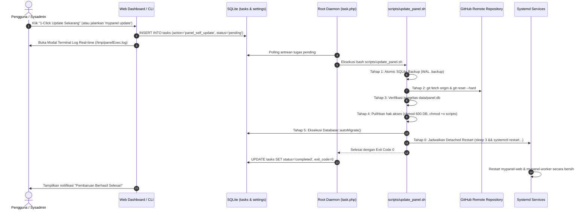

# Dokumentasi Sistem Panel Self-Updater: Almusa Panel

> **Panduan Lengkap Arsitektur, Keamanan Data, dan Penggunaan Sistem Pembaruan Mandiri (Self-Updater)**  
> Versi Dokumen: 1.0.0 · Tanggal Rilis: 29 Oktober 2026

---

## 📌 Daftar Isi
1. [Ringkasan & Filosofi Desain](#1-ringkasan--filosofi-desain)
2. [Arsitektur Alur Pembaruan (Workflow Architecture)](#2-arsitektur-alur-pembaruan-workflow-architecture)
3. [Jaminan Keamanan & Perlindungan Data Anti-Gagal](#3-jaminan-keamanan--perlindungan-data-anti-gagal)
   - [Atomic SQLite Backup (WAL-Safe)](#a-atomic-sqlite-backup-wal-safe)
   - [Isolasi Berkas Pengguna (.gitignore Enforcement)](#b-isolasi-berkas-pengguna-gitignore-enforcement)
   - [Pencegahan "Suicide Process Termination" (Detached Restart)](#c-pencegahan-suicide-process-termination-detached-restart)
   - [Uji Sintaks Pre-Flight & Proteksi Anti-Bricked](#d-uji-sintaks-pre-flight--proteksi-anti-bricked)
   - [Migrasi Basis Data Non-Destruktif](#e-migrasi-basis-data-non-destruktif)
4. [Panduan Penggunaan via Web UI (1-Click Update)](#4-panduan-penggunaan-via-web-ui-1-click-update)
5. [Panduan Penggunaan via Terminal CLI (`mypanel update`)](#5-panduan-penggunaan-via-terminal-cli-mypanel-update)
6. [Konfigurasi Repositori Kustom (Custom GitHub Upstream)](#6-konfigurasi-repositori-kustom-custom-github-upstream)
7. [Panduan Rilis bagi Pengembang & Kontributor GitHub](#7-panduan-rilis-bagi-pengembang--kontributor-github)
8. [Prosedur Pemulihan Darurat (Rollback Plan)](#8-prosedur-pemulihan-darurat-rollback-plan)

---

## 1. Ringkasan & Filosofi Desain

Sistem **Panel Self-Updater** di Almusa Panel dirancang untuk memberikan kemudahan pembaruan versi secara mulus bagi sysadmin dan pengguna biasa tanpa mengorbankan stabilitas server produksi.

### Fitur Kunci:
- **Badge Notifikasi Otomatis di UI:** Memberi tahu pengguna seketika rilis versi baru tersedia di GitHub tanpa memperlambat waktu muat dashboard (didukung SQLite Cache 6 jam).
- **1-Click Update di Web UI:** Memperbarui panel langsung dari peramban web dengan pemantauan log eksekusi terminal secara *live/real-time*.
- **CLI Update Terintegrasi:** Mendukung perintah `mypanel update`, `almusa update`, atau menu interaktif CLI nomor `9`.
- **Zero Data Loss Guarantee:** Database SQLite (`data/panel.db`), token akses masuk (`data/entrance.txt`), dan berkas rahasia (`data/secret.key`) **dijamin 100% tidak akan pernah tertimpa atau terhapus** saat proses update.

---

## 2. Arsitektur Alur Pembaruan (Workflow Architecture)

Pembaruan panel mengikuti prinsip **Privilege Separation (Pemisahan Hak Akses)**:



---

## 3. Jaminan Keamanan & Perlindungan Data Anti-Gagal

### a. Atomic SQLite Backup (WAL-Safe)
Almusa Panel beroperasi dalam mode **SQLite WAL (Write-Ahead Logging)**. Pada mode WAL, transaksi aktif dapat berada di berkas `-wal` dan `-shm`.
- Skrip pembaruan mengeksekusi perintah atomic online backup:
  ```bash
  sqlite3 "$PANEL_ROOT/data/panel.db" ".backup '$BACKUP_FILE'"
  ```
- Jika utilitas binary `sqlite3` tidak tersedia di sistem operasi, skrip melakukan pembersihan buffer WAL secara terkontrol:
  ```php
  \App\Core\Database::getInstance()->exec('PRAGMA wal_checkpoint(TRUNCATE);');
  ```
  lalu menyalin berkas database dan transaksi secara utuh ke direktori `/www/backup/` (atau direktori `backup/` panel).

### b. Isolasi Berkas Pengguna (`.gitignore` Enforcement)
Berkas `.gitignore` telah dikonfigurasi secara ketat untuk memblokir seluruh berkas spesifik *instance*:
```gitignore
# Runtime Panel Database & Generated Credentials
data/*.db
data/*.db-shm
data/*.db-wal
data/entrance.txt
data/initial_credentials.txt
data/secret.key
data/*.log
data/*.lock
data/cron_logs/*
!data/cron_logs/.gitkeep
!data/.gitkeep
```
Berkas `data/.gitkeep` dan `data/cron_logs/.gitkeep` dikunci dalam pelacakan Git agar struktur folder tetap ada saat fresh clone.

### c. Pencegahan "Suicide Process Termination" (Detached Restart)
* **Masalah Klasik:** Jika skrip `update_panel.sh` dijalankan sebagai anak proses (*child process*) dari `task.php` (`mypanel-worker.service`), memanggil `systemctl restart mypanel-worker` secara sinkron akan langsung memicu `SIGTERM` ke seluruh kelompok proses, memutus proses pembaruan di tengah jalan sebelum status database diperbarui.
* **Solusi Almusa:** Restart layanan dipisahkan (*detached*) ke dalam subshell independen dengan jeda waktu singkat:
  ```bash
  (
      sleep 3
      systemctl restart mypanel-web.service 2>/dev/null || true
      systemctl restart mypanel-worker.service 2>/dev/null || true
  ) >/dev/null 2>&1 &
  ```
  Hal ini memberikan waktu bagi daemon `task.php` untuk mencatat status `completed`, menulis banner penutup log, dan menutup koneksi database secara elegan.

### d. Uji Sintaks Pre-Flight & Proteksi Anti-Bricked
Sebelum layanan dimuat ulang, skrip memvalidasi sintaks berkas inti:
```bash
php -l "${PANEL_ROOT}/app/bootstrap.php"
php -l "${PANEL_ROOT}/public/index.php"
```
Jika terjadi kesalahan sintaks pada berkas kode versi baru, proses langsung dihentikan dan layanan yang sedang berjalan tidak akan dimatikan.

### e. Migrasi Basis Data Non-Destruktif
Pembaruan struktur database dilakukan secara aman melalui mekanisme `CREATE TABLE IF NOT EXISTS` dan `ALTER TABLE ADD COLUMN` terproteksi di `\App\Core\Database::autoMigrate()`. Data pengguna yang sudah ada tidak akan di-*drop* atau diinisialisasi ulang.

---

## 4. Panduan Penggunaan via Web UI (1-Click Update)

1. **Notifikasi Pembaruan:**
   - Pada baris navigasi atas (*topbar*) dan menu samping (*sidebar*), indikator versi akan menyala dengan label **"Update Tersedia (vX.X.X)"** jika rilis baru terdeteksi di GitHub.
2. **Membuka Dialog Pembaruan:**
   - Klik tombol notifikasi versi di topbar atau klik tombol badge versi di sidebar.
   - Modal pembaruan akan menampilkan:
     - Versi Terpasang vs Versi Terbaru di GitHub.
     - Tanggal rilis dan daftar catatan pembaruan (*changelog*).
3. **Menjalankan Pembaruan:**
   - Klik tombol **"1-Click Update Sekarang"**.
   - Sistem akan meminta konfirmasi. Setelah dikonfirmasi, tugas pembaruan langsung dijadwalkan ke antrean daemon.
   - Modal terminal eksekusi akan terbuka secara otomatis dan menampilkan progres langkah demi langkah secara *real-time*.
4. **Pemeriksaan Manual:**
   - Pengguna dapat mengecek pembaruan seketika dengan mengklik tombol **"Periksa Ulang"** di dalam modal (memaksa pengecekan langsung ke GitHub tanpa menunggu jeda cache 6 jam).

---

## 5. Panduan Penggunaan via Terminal CLI (`mypanel update`)

Bagi sysadmin yang bekerja melalui sesi SSH, pembaruan dapat dilakukan langsung melalui terminal:

### Opsi A: Perintah Langsung
```bash
mypanel update
# atau jika menggunakan path skrip lokal
/www/panel/cli.sh update
```
Sistem akan menampilkan versi terpasang dan meminta konfirmasi sebelum eksekusi dimulai.

### Opsi B: Menu Interaktif CLI
Jalankan perintah `mypanel` tanpa argumen:
```text
================================================================
            ALMUSA SERVER CONTROL PANEL (SLEMP EDITION)          
================================================================

Silakan pilih nomor menu:
 1) Restart Panel
 2) Stop Panel
 3) Start Panel
 4) Status Layanan
 5) Tampilkan Informasi Login & URL (Default)
 6) Reset Password Admin
 7) Ganti Port Panel
 8) Ganti Secret Entrance Path
 9) Update Almusa Panel ke Versi Terbaru
 0) Keluar

Pilihan Anda [0-9]: 9
```

---

## 6. Konfigurasi Repositori Kustom (Custom GitHub Upstream)

Bagi pengembang yang melakukan *forking* repositori atau menggunakan repositori privat organisasi:
1. Buka menu **Pengaturan** (`/settings`) di web panel.
2. Pada bagian **Umum**, temukan kolom:
   **URL Repositori GitHub (Self-Updater)**.
3. Ubah URL ke repositori Anda (misal: `https://github.com/organisasi-anda/almusa-panel`).
4. Klik **Simpan Pengaturan**. Pengecekan versi selanjutnya akan secara otomatis merujuk ke repositori tersebut.

---

## 7. Panduan Rilis bagi Pengembang & Kontributor GitHub

Saat merilis pembaruan baru untuk Almusa Panel di GitHub, ikuti format standar berikut:

### 1. Perbarui Berkas `version.json`
Perbarui versi semantik, nomor build, tanggal rilis, dan poin-poin perubahan:
```json
{
  "version": "1.0.1",
  "build": 20261115,
  "release_date": "2026-11-15",
  "repo_url": "https://github.com/uwaisalqorni/almusa-panel",
  "raw_version_url": "https://raw.githubusercontent.com/uwaisalqorni/almusa-panel/main/version.json",
  "changelog": [
    "Peningkatan kestabilan worker daemon task queue",
    "Pembaruan modul Nginx HTTP/2 & SSL cipher suites",
    "Perbaikan tampilan responsif pada perangkat mobile"
  ]
}
```

### 2. Commit & Buat Git Tag
```bash
git add version.json
git commit -m "Release v1.0.1"
git tag -a v1.0.1 -m "Release v1.0.1"
git push origin main --tags
```
Semua instalasi Almusa Panel di seluruh dunia akan mendeteksi rilis `v1.0.1` secara otomatis dalam kurun waktu 6 jam (atau seketika saat tombol *Periksa Ulang* ditekan).

---

## 8. Prosedur Pemulihan Darurat (Rollback Plan)

Jika setelah proses pembaruan terjadi kendala jaringan atau kegagalan yang tidak terduga, data Anda tetap aman dalam arsip cadangan pre-update.

### Mengembalikan Database dari Cadangan Otomatis:
Setiap kali update dijalankan, salinan database disimpan di `/www/backup/panel_db_backup_<TIMESTAMP>.db`.

Untuk memulihkan database secara manual:
```bash
# 1. Hentikan worker panel
systemctl stop mypanel-worker mypanel-web

# 2. Cari berkas cadangan terakhir
ls -la /www/backup/panel_db_backup_*.db

# 3. Salin kembali berkas cadangan ke data/panel.db
cp -p /www/backup/panel_db_backup_YYYYMMDD_HHMMSS.db /www/panel/data/panel.db
chmod 600 /www/panel/data/panel.db

# 4. Nyalakan kembali layanan panel
systemctl start mypanel-web mypanel-worker
```

---

<p align="center">
  <strong>Almusa Server Control Panel</strong> — Tangguh, Aman, dan Siap Produksi.
</p>
